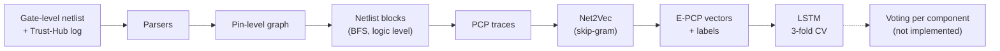
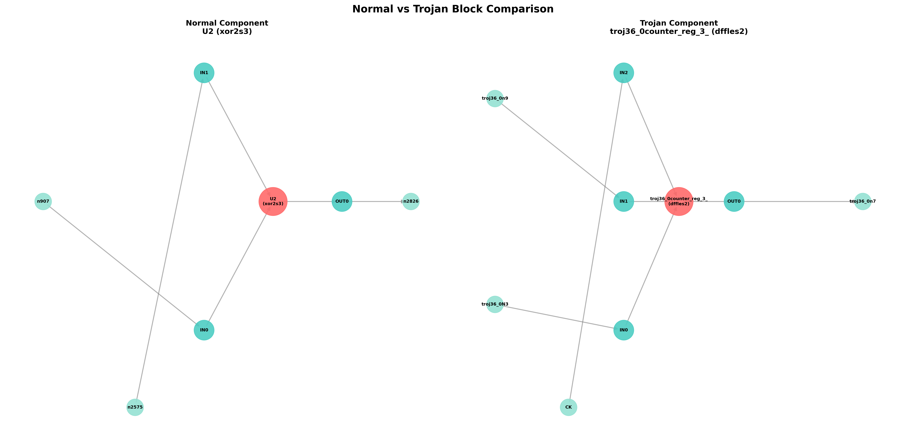
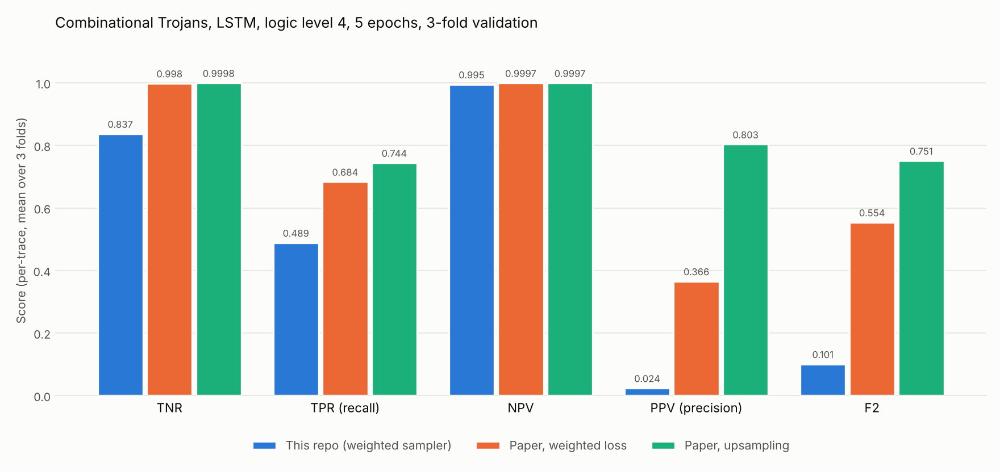
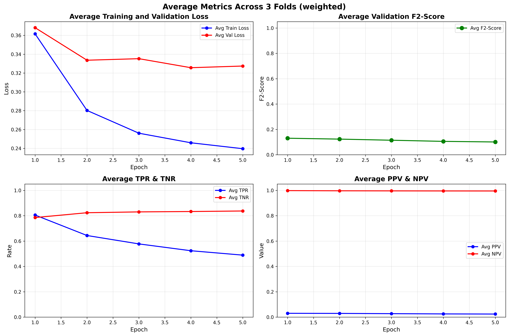

# Hardware Trojan Detection with Block-based Netlist Information Extraction

A Python implementation of the data-driven hardware Trojan detection pipeline from

> Shichao Yu, Chongyan Gu, Weiqiang Liu and Máire O'Neill, *Deep Learning-based Hardware Trojan Detection with Block-based Netlist Information Extraction*, IEEE Transactions on Emerging Topics in Computing, 2021. DOI 10.1109/TETC.2021.3116484

The parsing, graph, block extraction and trace generation stages follow the paper's Algorithms 1 and 2 closely. The embedding and LSTM stages are implemented too, and trained on a subset of the Trust-Hub LEDA benchmark. Voting and the CNN model are not implemented yet, see [Known gaps](#known-gaps).

## The paper in short

A hardware Trojan (HT) is a malicious circuit hidden in a chip design. It usually has a trigger part that waits for a rare condition and a payload part that does the damage. Most machine learning detectors for gate-level netlists rely on hand-crafted features, so they need prior knowledge about the circuit and the Trojan type.

The paper instead treats a netlist like a text corpus and lets the network learn the features.

1. Parse the gate-level netlist and split every cell into separate pin vertices to get a pin-level graph.
2. For each component, run a BFS up to a depth called the *logic level* to get its netlist block (Algorithm 1).
3. Walk the block from inputs to outputs and write each path as a short "sentence" of Pin-Cell-Pin (PCP) words such as `DIN1_nnd4_Q` (Algorithm 2).
4. Train a skip-gram model with negative sampling (Net2Vec) on those sentences to get a 100-dimensional vector per PCP word.
5. Classify every embedded trace as Trojan or normal with a 2-layer LSTM (or a LeNet-style CNN), using class balancing and K-fold validation.
6. Decide the class of each component by majority vote over all traces of its block.

On 914 LEDA-library samples from Trust-Hub, the paper reports after voting (logic level 4, upsampling, LSTM, 5 epochs)

| Trojan type | TPR | TNR | PPV | NPV |
|---|---|---|---|---|
| Combinational | 79.29% | 99.97% | 87.75% | 99.94% |
| Sequential | 93.46% | 99.99% | 98.92% | 99.92% |



## What is implemented

| Paper step | What it does | Where |
|---|---|---|
| 1 | Verilog netlist and Trust-Hub label parsing, cell library inferred from the netlist | `src/parser/` |
| 2 | Cell-pin splitter, pin-level directed graph | `src/graph/` |
| 3 | BFS netlist block extraction (Algorithm 1) | `src/extraction/block_tree_extractor.py`, `netlist_block_tree.py` |
| 4 | PCP trace generation with FLATTEN (Algorithm 2), tokens in `PIN_CELLTYPE_PIN` form | `src/traces/pcp_trace_generator.py` |
| 5 | Net2Vec, skip-gram with negative sampling (gensim) | `notebooks/net2vec.ipynb` |
| 6 and 7 | PCP to E-PCP translation and labelling | `notebooks/EPCP_Pipeline.ipynb` |
| 8 and 9 | Class balancing, 3-fold training, metrics | `notebooks/LSTM_Classifier_Training.ipynb` |
| 10 to 12 | Voting, CNN model | not implemented |

`extract_all_traces.py` runs steps 1 to 4 over many benchmark netlists with checkpointing. `src/visualization/` draws netlist blocks.

## Repository layout

```
.
├── src/
│   ├── parser/            Verilog and label parsers
│   ├── graph/             pin-level graph construction
│   ├── extraction/        netlist block extraction (Algorithm 1)
│   ├── traces/            PCP trace generation (Algorithm 2)
│   ├── visualization/     block plots
│   └── utils/config.py    default paths and parameters
├── notebooks/             Net2Vec, E-PCP dataset, LSTM training
│   └── test_models/       small trained Word2Vec model and vocabulary
├── tests/                 step by step tests for each stage
├── data/
│   ├── raw/               example netlist (s15850_T436) and its label file
│   └── processed/         parsed JSON and example PCP traces
├── output/visualizations/ block plots for the example netlist
├── results/lstm_weighted/ per-fold metrics, plots and trained LSTM weights
├── docs/figures/          figures used in this README
├── extract_all_traces.py  batch trace extraction
└── requirements.txt
```

## Getting started

### Install

```bash
git clone https://github.com/AmirAAZ818/DL_trojan_detection.git
cd DL_trojan_detection
pip install -r requirements.txt
```

### Try it on the bundled example

The repository ships one Trust-Hub netlist (`s15850_T436`, 24 Trojan components) so the first four stages can be run right away.

```bash
python tests/test_paper_algorithms.py data/raw/netlists/s15850_T436.v data/raw/labels/log.txt 4
```

This parses the netlist, builds the pin-level graph, extracts all blocks, generates the PCP traces and writes them to `data/processed/pcp_traces/`. The last argument is the logic level. The earlier tests (`tests/test_step1.py` to `test_step4.py`) exercise each stage on its own.

To plot a Normal and a Trojan block side by side, see `src/visualization/block_visualizer.py`.



### Run the full pipeline

The benchmark itself is not redistributed here. Download the LEDA-library Trojan benchmarks (TRIT-TC and TRIT-TS) from [Trust-Hub](https://trust-hub.org/) and arrange them like this.

```
Datasets/
└── TRIT-TC/TRIT-TC/c2670_T000/
    ├── c2670_T000.v
    └── log.txt
```

Then run the stages in order.

```bash
# 1. PCP traces for the Word2Vec corpus (edit benchmarks and T-ID ranges in main())
export TROJAN_DATASET_ROOT=/path/to/Datasets
python extract_all_traces.py

# 2. notebooks/net2vec.ipynb              trains the PCP embedding
# 3. notebooks/EPCP_Pipeline.ipynb        builds e_pcp_dataset.npz
# 4. notebooks/LSTM_Classifier_Training.ipynb   trains and validates the LSTM
```

The notebooks still contain a few absolute paths from the original machine and some Google Colab cells (drive mount, `gdown`), so adjust the path cells at the top before running them. The generated corpus and dataset files (`vocabulary_traces*.txt`, `*.npz`) are several GB and are git-ignored. Regenerate them with the steps above.

## Results

### Setup compared to the paper

| | Paper (Experiment 1, Table 6) | This repository |
|---|---|---|
| Benchmark | LEDA, 24 combinational netlists from 8 host circuits | LEDA TRIT-TC, 51 netlists (`c2670_T000` to `c2670_T050`), one host circuit |
| Traces | not listed per run | 722,531 total, 5,902 Trojan (0.82%) |
| Logic level | 4 | 4 |
| Embedding | skip-gram, negative sampling (5), 100 dimensions | same, gensim, window 5, 4 epochs, 383 words learned from 71 netlists |
| Detector | 2-layer LSTM, hidden size 128 | same, 250,114 parameters |
| Balancing | upsampling, downsampling, weighted loss, none | weighted sampler (balanced draws, about 50/50 per epoch) |
| Validation | 3-fold, folds split by netlist | 3-fold on shuffled traces, not grouped by netlist |
| Training | 5 epochs, batch 32 | 5 epochs, batch 32, Adam with learning rate 1e-3 |
| Voting | yes, in the final numbers | not yet |

### Per-trace validation metrics

Only the paper's Table 6 is directly comparable, since it reports per-trace metrics on validation folds before voting. The paper rows below are the mean of its three folds, computed from Table 6. The weighted sampler used here is closest in spirit to the paper's upsampling and weighted loss variants, so both are shown.

| Metric | Paper, upsampling | Paper, weighted loss | This repository |
|---|---|---|---|
| TNR | 0.9998 | 0.9983 | 0.8372 |
| TPR (recall) | 0.7443 | 0.6839 | 0.4889 |
| NPV | 0.9997 | 0.9997 | 0.9950 |
| PPV (precision) | 0.8035 | 0.3656 | 0.0241 |
| F2 | 0.751 | 0.554 | 0.1008 |



Values for this repository are from epoch 5, averaged over the three folds.

| Fold | TNR | TPR | NPV | PPV | F2 |
|---|---|---|---|---|---|
| 1 | 0.8338 | 0.4984 | 0.9952 | 0.0237 | 0.0994 |
| 2 | 0.8396 | 0.4858 | 0.9950 | 0.0240 | 0.1002 |
| 3 | 0.8382 | 0.4825 | 0.9948 | 0.0247 | 0.1026 |

Per-fold curves and confusion matrices are in `results/lstm_weighted/`.



### Reading the results

The pipeline runs end to end and the detector learns a useful signal, but precision is far below the paper. With only 0.82% Trojan traces, a false positive rate of about 16% gives roughly 40 thousand false positives per fold against about 1 thousand true positives, which is why PPV sits near 0.02 even though NPV stays above 0.99.

The trend over epochs also differs. Recall drops from 0.81 at epoch 1 to 0.49 at epoch 5, TNR creeps up from 0.79 to 0.84, and the validation loss stops improving after epoch 2 while the training loss keeps falling. The paper reports F2 rising over the five epochs on its test set (0.708 to 0.797, Table 8), although that table uses a different split.

A few differences from the paper could explain part of the gap. None of them has been tested yet.

- Traces have at most 2 × logic level − 1 = 7 tokens, but they are zero-padded to length 9 and the LSTM reads its final hidden state after the padding steps. The paper's LSTM sees exactly the real trace.
- The PCP words keep the cell size suffix (`nor2s1`, `xor2s3`), while the paper removes it to make words more general. This gives a larger vocabulary (383 words, against 204 in the paper's example).
- The data covers a single host circuit, and folds are random over traces, not grouped by netlist.
- Class balancing here uses a weighted sampler and not a weighted loss.
- The final paper numbers include voting over each netlist block, which is not implemented here.

### What cannot be compared yet

The paper's headline numbers (Tables 8 and 10) come from a test set of 80 netlists with voting, and cover sequential Trojans and the CNN as well. This repository has only run combinational Trojans with the LSTM and without voting, so those numbers are listed above for reference and not reproduced.

## Known gaps

- Step 12 (voting inside each netlist block) and the CNN detector are missing.
- Only the weighted-sampler run is saved under `results/`. Runs with upsampling, downsampling and no balancing, plus the sequential Trojan set (TRIT-TS), are still to do.
- Folds should be split by netlist, as in the paper, to avoid traces from the same circuit appearing on both sides.
- The notebooks need their absolute paths and Colab cells cleaned up.

## Author

Amirhossein Abolhassani Zeraatkar, Shahid Bahonar University of Kerman

Benchmark netlists come from [Trust-Hub](https://trust-hub.org/) and remain under their own terms. The paper's figures are not reproduced here, please refer to the original publication.
